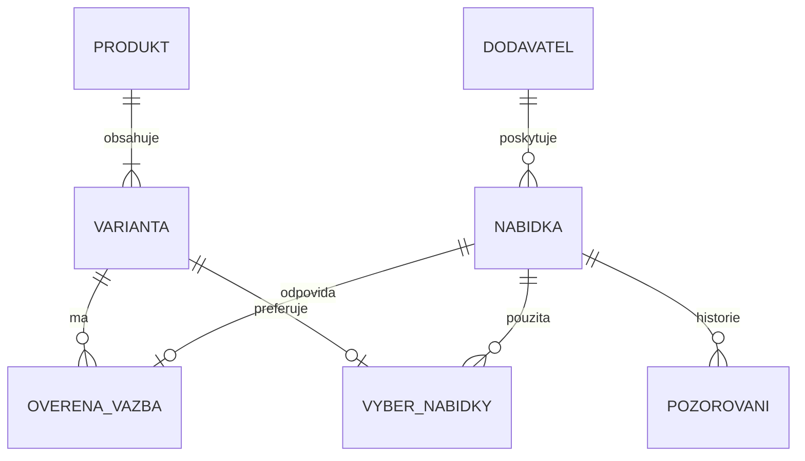

# Varianty, nabídky dodavatelů a přesné odkazy

Stav: **návrh k implementaci**, 25. 10. 2026. Tento dokument neoznačuje níže uvedené tabulky, API ani migrace za hotové. Vychází z kódu `6b339c0` a exportu katalogu z 25. 10. 2026 11:09 českého času. Popis současného provozu zůstává v [product-variants.md](product-variants.md) a [supplier-prices.md](supplier-prices.md).

## Rozhodnutí

Základní prodejnou jednotkou bude vždy **varianta**. Produkt sdružuje společný obsah a varianty. Každá varianta může mít libovolný počet ověřených nabídek různých dodavatelů; pro prodej se vybere právě jedna způsobilá nabídka, nebo žádná. Produkt bez rozlišovacích vlastností má jednu výchozí variantu. Jeho zákazník neuvidí zbytečný výběr „výchozí varianta“.

Zachováme současná stabilní `product_key` a `variant_key`. ID není název, slug, URL, EAN ani kód dodavatele. Změna popisku nebo překladu nesmí změnit identitu. Dodavatelský URL je měnitelná adresa nabídky; k identitě nabídky patří také dodavatel, jeho produktové a variantní ID a kontext nabídky.

Jedna externí přesná nabídka nesmí být automaticky přiřazena ke dvěma rozdílným místním variantám. Více místních karet téhož zboží je konflikt katalogu k vyřešení, nikoli důvod znásobovat sklad. Kandidáti na spárování mohou být nejednoznační; teprve potvrzená vazba má výše uvedenou jednoznačnost.

Zůstává PHP 8.1+, MySQL/MariaDB, stávající cron a jednoduché PHP/JS rozhraní. Není nutná nová aplikační platforma, Redis, headless prohlížeč ani samostatná služba. Nové odpovědnosti oddělíme do menších služeb místo dalšího rozšiřování `PriceManager`.

## Co již existuje a co chybí

| Oblast | Ověřený stav | Důsledek pro návrh |
| --- | --- | --- |
| Identita a sklad variant | `ProductVariants` generuje náhodná 32znaková ID; `ProductVariantRepository` je uchovává, hlídá verze a zakazuje přepis kombinace pod stejným ID. | ID ponechat. Není potřeba přejmenovat všechny varianty nebo změnit formát ID. |
| Jednoduchý produkt | Společný sklad v `shop_product_inventory`; `ProductVariants::choices()` nepřijímá prázdné vlastnosti. Košík a rezervace rozlišují dva režimy. | Výchozí varianta vyžaduje úpravu modelu i skladu a pokladny, nestačí přidat parametr do URL. |
| Dodavatelské odkazy | `shop_product_supplier_links` ukládá `product_key`, popisek a URL. Není zde vazba na variantu. `replace()` staré řádky nahrazuje. | Současné ID odkazu není vhodná stálá identita nabídky pro objednávku. |
| Prodávající a nákupní ceny | `shop_product_sales.partner_id` platí pro celý produkt; variantní ceny jsou v `variant_prices_json`. | Nelze spolehlivě vyjádřit různé dodavatele jednotlivých velikostí. Ceny potřebují původ v konkrétní nabídce. |
| Cenový automat | Umí ověřit rozsah variant z nabídek, někdy i jejich jednotlivé ceny; práce je ale zařazena po produktu. Cache a limity jsou sdílené. | Parsery a bezpečný HTTP klient znovu použít; výsledky ukládat jako samostatné nabídky a pozorování. |
| Veřejný detail | `index.php` neřeší parametr výběru varianty; `product-variants.js` mění cenu/obrázek, ale nezapisuje výběr do adresy. | Přidat serverové předvybrání i synchronizaci adresy v JS. |
| Objednávka | Ukládá variantu, její volby, cenu a snímek prodávajícího. Interní odkazy se nyní dohledávají podle současného produktu. | Nové objednávky potřebují soukromý neměnný snímek konkrétní dodavatelské nabídky. Staré objednávky nepřepočítávat. |

Výchozí inventura katalogu: **395 produktů, 719 řádků variant, 567 dodavatelských odkazů**, 159 produktů má více odkazů. Sklad variant používá 214 produktů. Dalších 179 nemá variantní řádky ani volby. Dva produkty mají varianty připravené, ale režim skladu variant vypnutý: Altra Lone Peak 9+ GTX (16 řádků) a Petzl Actik 2025 (4 řádky). Počty jsou snímek, migrační náhled je musí vždy zjistit znovu.

Konkrétní kontrolní případy:

- Místní Altra Timp 6 Gore-Tex má černé a zelené varianty a pouze odkaz na úvodní stránku Gramina. Uživatel dodal detail Hudy. Při technickém čtení tento detail obsahoval `ProductGroup` s velikostmi, barvou, dostupností, cenou a URL jednotlivých variant. Neznamená to, že Hudy nabízí všechny místně vytvořené kombinace nebo že lze celý produkt přepnout na Hudy jedním odhadem.
- Odkaz uživatele na Gramino Terraventure **4** vrací nabídky více barev a velikostí, SKU, GTIN a odlišné ceny některých variant. V místním katalogu je Terraventure **5**. Tyto modely se nesmí spárovat.
- Dřívější kontrola ukázala rozdílnou cenu základní a Proof varianty Aevor. Nejnižší cena modelu není automaticky cenou všech variant.

## Identity a vlastnosti variant

Každý produkt bude mít alespoň jednu evidovanou variantu; nemusí mít žádnou právě prodejnou variantu. Výchozí varianta používá prázdný objekt vlastností `{}` a příznak `is_default`. Platí jen pro výrobek bez rozlišovaných kombinací. Chybějící znalost velikosti či barvy není výchozí varianta.

- Stávající ID se přenesou beze změny. Nová ID vznikají jednou a mají unikátní omezení v DB; opakování importu/migrace znovu použije uloženou identitu.
- `sku` je interní nepovinný kód. `supplier_sku`, výrobní `mpn` a GTIN jsou odlišné údaje. Dodavatelské SKU není globální identifikátor.
- Vlastnosti dostanou stálý technický klíč a hodnotu; zobrazované názvy a překlady budou oddělené. U bot např. `size_system=EU`, `size_value=42.5`, `color_code=...`; původní text „42,5 EU“ se zachová pro audit.
- Povolené vlastnosti zůstávají rozšiřitelné: velikost, barva, šířka, délka, zip, teplota, objem, počet kusů v balení apod. Typ, jednotka a rozměrový systém jsou explicitní; nevznikne pevný seznam jen pro boty.
- Normalizace nesmí smazat význam. EU 42 není US 42, pánské nejsou dámské, Wide není Regular, GTX není běžná verze a balení dvou kusů není jeden kus. Převod velikostí je možný pouze z ověřené tabulky konkrétní značky/modelu.
- Textové aliasy se evidují s rozsahem značky/modelu/dodavatele a původem. „BLACK/BLACK“ a „Černá“ nejsou univerzálně totožné bez ověření daného modelu. Překlad názvu může zachovat ID; skutečná změna prodávaného typu zakládá novou variantu.
- Generování kartézského součinu z barev a velikostí zůstane jen výslovná správcovská pomůcka s náhledem. Automatické doplnění dodavatele zakládá nabídky existujících variant; samo nevytváří ani nezveřejňuje nové místní kombinace a nedoplňuje skladové kusy.
- Pokud se jednoduchý produkt později rozšíří, jeho staré ID lze přiřadit známé původní kombinaci jen s důkazem totožnosti. Neznámé kusy se nerozkopírují do všech nových velikostí. Rozdělení zásob potřebuje vlastní ověřitelný krok.

## Datový model

Názvy níže jsou návrh; implementace musí používat stávající mechanismus prefixu tabulek. JSON slouží pro omezené rozšiřitelné atributy a snímky, nikoli místo relačních klíčů, cen, termínů nebo indexovaných stavů.

| Entita / tabulka | Hlavní data a pravidla |
| --- | --- |
| `shop_products` | Malý registr stabilních `product_key`, společná verze a archivace. Doplnit z existujících klíčů; obsah a překlady zůstávají v revizích. Poskytne skutečného rodiče pro FK místo odkazu na nahodilou revizi. |
| `shop_product_variants` | Zachovat `(product_key, variant_key)`, SKU, stav, cenu, fotografie a zásoby. Přidat typ výchozí varianty a verze. Nejvýše jedna aktuální výchozí varianta na produkt; výchozí a aktivní rozlišené varianty nesmějí prodávat stejné kusy zároveň. |
| `shop_variant_attributes` | `(product_key, variant_key, attribute_key)`; normalizovaná typovaná hodnota, jednotka/systém a původní text. Zobrazovací překlady patří do definic vlastností, ne do identity varianty. `choices_json` přechodně tvoří odvozený kompatibilní výstup. |
| `shop_variant_identifiers` | Ověřené GTIN/MPN s typem, jmenným prostorem značky, původem a stavem. GTIN ukládat jako řetězec včetně nul a ověřovat kontrolní číslici; různé zápisy téhož GTIN normalizovat. Konflikt zastaví automatické přiřazení. |
| `shop_supplier_sources` | Technický zdroj s trvalým klíčem, vazbou na existujícího prodávajícího `partner_key`, adaptérem, schválenými doménami, zemí/trhem, měnou a možnostmi čtení. Jedna právní osoba může mít více domén/zdrojů. Doména sama není právní identita prodávajícího. |
| `shop_supplier_offers` | Stálý `offer_key`, `source_key`, neprázdný `external_identity`, externí ID produktu/varianty, SKU, původní identifikátory a vlastnosti, aktuální přesný URL, URL modelu, stav archivace, verze. Identita zahrnuje trh, prodejce, stav zboží a balení, pokud je zdroj rozlišuje. Jedinečnost `(source_key, external_identity)`. |
| `shop_variant_supplier_offers` | Ověřená vazba nabídky na `(product_key, variant_key)`, metoda důkazu, verze místní identity i externí identity, původ a autor potvrzení, poslední ověření, případně zámek ručního přiřazení. Jedna aktuální vazba na `offer_key`; změny mají audit. |
| `shop_supplier_match_candidates` | Návrhy párování včetně více možných variant, přesného důvodu a pozitivních/negativních důkazů. Stavy `candidate`, `needs_review`, `rejected`, `confirmed`, `conflict`; potvrzení zapisuje ověřenou vazbu v transakci. Zamítnutý kandidát se při každém načtení nevrací bez nového důkazu/verze identity. |
| `shop_supplier_offer_observations` | Neměnná historie: nabídka, čas skutečného načtení, platnost, cena v nejmenší měnové jednotce, měna, režim DPH/podmíněná cena, dostupnost, případně výslovný počet, dodání, identita zdroje, parser/verze, otisk a omezený důkaz. Samostatně zaznamenat chybu načtení. |
| `shop_supplier_offer_urls` | Historie původní, přesné a přesměrované adresy s časem, důvodem a ověřením stejné identity. Nová adresa nepřepisuje původní snímek objednávky. |
| `shop_variant_sales` | Výběrová a cenová politika varianty, volitelný `selected_offer_key`, použité pozorování, verze, ruční zámek výběru/nákupní/prodejní ceny a odvozený aktuální výsledek. Výchozí preferovaný dodavatel a cenové pravidlo mohou být společné pro produkt. Jedna konkrétní nabídka se vybírá až pro variantu. |
| `shop_order_item_procurement` | Soukromý snímek pro každou novou objednávkovou položku: klíč varianty, nabídky a zdroje, externí ID, přesný URL, GTIN/SKU, vlastnosti, pozorovaná cena/dostupnost/čas, zvolený prodávající a metoda shody. Verze formátu, jedinečnost `(order_id, item_key)`. |

`shop_supplier_offers` může existovat bez potvrzené místní vazby. URL nemusí být unikátní: některý dodavatel má jeden URL pro více velikostí a rozlišuje je jen ve svém API. `external_identity` je vždy neprázdná, deterministicky sestavená adaptérem ze známých identifikátorů; při jejich absenci z ověřeného úplného URL a kontextu. V takovém případě má nabídka slabší identitu a změnu adresy nelze automaticky považovat za tutéž nabídku. Identifikátory se nesmějí domýšlet ze vzoru čísel.

Jeden řádek nabídky znamená konkrétní prodejný typ v daném kontextu. Obecný odkaz na model, kategorii nebo homepage je **zdroj k vyhledání**, ne způsobilá varianta. Pokud dodavatel deklaruje jednu cenu pro všechny výslovně vyjmenované kombinace, lze z jednoho zdroje vytvořit více přesných nabídek s důkazem společného rozsahu. Dostupnost se tím nesmí dědit, pokud společný rozsah dostupnosti není také doložen.

Vazby na variantu a nabídku musí být omezené FK nebo ekvivalentní transakční kontrolou tam, kde současný model FK ještě neumožní. Zákaz tvrdého smazání použitých identit; archivace zachová objednávky. Povinné indexy: varianty podle produktu, nabídky podle zdroje/external identity, potvrzená vazba podle varianty i nabídky, pozorování `(offer_key, fetched_at, id)` a úlohy podle `(state, next_at, id)`. Stav posledního pozorování lze držet jako ukazatel pro rychlé čtení; historie zůstává zdrojem důkazu.

Registr produktů musí zahrnout i klíče odkazované historickými variantami, rezervacemi či objednávkami. Již odstraněné karty se evidují pouze jako archivované identity, znovu se nezveřejňují. Před přidáním FK se vypíšou osiřelé vazby. Aktivní kombinace jednoho produktu jsou jedinečné podle normalizované sady vlastností; toto pravidlo musí chránit i souběžné zápisy, ne pouze PHP validátor. Dlouhé externí identity se indexují pevným otiskem s následným porovnáním celého původního identifikátoru. Identifikátory používají binární porovnávání, aby kolace neslučovala různá ID. Konkrétní SQL omezení a opakovatelný upgrade se ověří na MySQL i MariaDB.

Cenový automat nezapisuje zbytečně celou katalogovou revizi při každém stejném výsledku. Shodný fetch/offer/parser se deduplikuje; důkazy použité pro přijetí ceny či objednávku se zachovají. Běžná nevyužitá pozorování lze později promazávat podle nastavitelné retenční politiky, bez mazání aktivních vazeb a objednávkových snímků.

Peníze v nových záznamech budou celočíselné (CZK v haléřích), bez `float`. Nynější ceny produktu v celých Kč se zachovají jako kompatibilní prodejní výstup; zaokrouhlení nastane jednou podle politiky. První verze automaticky použije pouze jednoznačnou běžnou CZK nabídku. Klubová cena, jiná měna, neznámý režim daně, jiné balení nebo nejasné poštovné nesmějí být vydávány za srovnatelnou finální nákupní cenu. Neznámé poštovné není nula.

## Přesné URL ve vlastním obchodě

Navržený tvar: `/cs/produkt/<slug>?variant=<variant_key>`. Jeden parametr obsahuje místní neměnnou identitu; barvu a velikost již najde server. Není potřeba kopírovat názvy parametrů každého dodavatele.

1. PHP ověří formát, příslušnost varianty k produktu a její stav. Už první HTML ukáže správnou cenu, fotografii, dostupnost, vybrané hodnoty a ID pro košík; funguje i bez JS.
2. JavaScript při změně kombinace upraví URL přes History API, aktualizuje zobrazení a obslouží návrat vpřed/zpět. Odkaz lze zkopírovat, otevřít v nové kartě a zachovat při změně jazyka.
3. Bez parametru se při více variantách zobrazí skutečný výběr; při jedné prodejné variantě je výběr jednoznačný. Není dovoleno neznámé ID tiše zaměnit za první dostupnou velikost.
4. Chybné/nepatřící ID vrátí 400/404 podle typu chyby. Známou vyprodanou variantu lze zobrazit se skutečným stavem a vypnutým nákupem. Trvale vyřazená varianta má výslovné sdělení nebo 410; nesmí zákazníkovi podstrčit jinou kombinaci.
5. Změna slugu zachová parametr. Přesměrování po sloučení původní karty lze rozšířit o `target_variant_key` jen tam, kde migrační záznam dokládá přesné přiřazení. Jinak vede na výběr produktu bez předstírání konkrétní varianty.
6. Pro jeden společný detail zůstane jedna kanonická adresa produktu. Variantní URL jsou funkční vstupy, nevznikají kopie popisů. `ProductGroup`/`Product`/`Offer` budou odpovídat skutečně zobrazeným variantám a cenám a vzniknou již v PHP. U jediného typu stačí `Product`. Privátní dodavatelské URL, marže a diagnostické údaje nejsou součástí veřejného JSON-LD.

Tento princip odpovídá doporučení Google pro předvýběr varianty vlastní URL a jednu kanonickou adresu společného detailu. Neznamená příslib konkrétního zobrazení ve vyhledávání.

## Automatické nalezení a potvrzení nabídek

Pořadí zdrojů: smluvený feed/API → veřejné strukturované varianty na známém detailu → konkrétní adaptér pro serverová data obchodu → vyhledání kandidáta podle GTIN nebo značky a MPN. Vyhledávač či podobnost názvu poskytují kandidáta, ne důkaz shody.

První adaptéry: Gramino, Hudy a Pod 7 kilo, protože pro ně již existují parsery a reálné případy. Další zdroje přidávat postupně s testy a profilem prodávajícího. Neomezené hledání všech obchodů ani automatické zakládání ověřených prodávajících není cílem. Každý nový zdroj potřebuje povolené domény a doložený způsob čtení. Alza HTTP 403 zůstává konkrétní blokace; řešení je dostupný povolený feed/API, nikoli obcházení ochrany.

Každý adaptér poskytne společný výsledek:

- produktovou identitu a úplnost seznamu variant;
- externí ID produktu a variant, SKU/MPN/GTIN, původní i normalizované vlastnosti;
- přesný odkaz pro člověka a oddělený technický zdroj čtení;
- cenu, její podmínky, měnu, dostupnost a případný výslovný počet;
- doklad shody vybraného URL s vrácenou variantou, čas, verzi parseru a pokrytí zdroje.

U Hudy je kombinace `variant` a `size` jedna dodavatelská identita; odstranění `size` může změnit výsledek. U Gramina se zachová celé `v_id`. Odstraňovat lze jen známé měřicí parametry podle pravidel adaptéru, ne libovolný query string. Původní URL uchovat vedle normalizovaného. Pokud API nepodporuje přesný veřejný odkaz, evidovat `deep_link_supported=false`, externí ID a pouze skutečný existující URL; nevyrábět nefunkční odkaz.

### Pravidla párování

| Důkaz | Výsledek |
| --- | --- |
| Již potvrzené externí ID a shodná identita při opakované kontrole | Aktualizovat pozorování; rozpor barvy, velikosti, balení nebo modelu vazbu zablokuje. ID samo není oprávnění ignorovat změnu obsahu. |
| Ověřený GTIN a kompatibilní model/varianta bez rozporných údajů | Lze automaticky potvrdit. Chybně použitý nebo duplicitní GTIN vytvoří konflikt. |
| Značka + ověřené MPN varianty + všechny rozlišovací vlastnosti | Lze automaticky potvrdit při právě jedné možné shodě. MPN celého modelu bez velikosti nestačí. |
| Ověřený totožný model + úplná přesná kombinace vlastností z důvěryhodného adaptéru | Lze automaticky potvrdit jedinou shodu; uchovat důkaz a rozsah použitých aliasů. |
| Podobný název, fotografie, stejná cena, neúplná kombinace nebo AI odhad | Pouze kandidát k ověření. Žádná změna prodejní ceny ani dodavatele. |
| Rozdílná generace, pohlaví, šířka, velikostní systém, balení nebo rozporné ID | Zamítnout / konflikt s konkrétním důvodem. |

Pravidla jsou vysvětlitelná, ne jediné neurčité procento podobnosti. AI může navrhovat kandidáty či aliasy, ale nesmí svým tvrzením nahradit chybějící identifikátor. Seznam navržených doplnění obsahuje variantu, dodavatele, URL, shodné i chybějící údaje a navrženou změnu. Potvrzení celé dávky smí zahrnout jen řádky, které splňují stejná přísná pravidla.

Ruční potvrzení nesmí vyrobit chybějící cenu, aktuální dostupnost nebo schopnost automatického nákupu. Při pozdějším rozporu dodavatelských dat se i ruční vazba zablokuje; správce vidí důvod a předchozí stav.

## Výběr dodavatele a výpočet ceny

Výběr je **po variantě**. Produkt má výchozí preferenci dodavatele a cenotvorbu, varianta může mít výjimku. Po výběru konkrétní varianty se zákazníkovi v asistovaném režimu ukáže právě jeden skutečný prodávající a správný rozpis. Dvě velikosti téhož produktu mohou mít různé zvolené dodavatele; objednávka proto nesmí odvozovat prodávajícího jen z `product_key`.

Výchozí migrace zachová současně zvoleného prodávajícího a ruční ceny. Nabídky dalších dodavatelů se shromažďují jako zálohy. Nově nalezená levnější nabídka sama prodávajícího nepřepne.

Politiky:

- **Pevná nabídka/dodavatel** – výchozí bezpečné chování. Při nedostupnosti upozornit a připravit návrh náhrady.
- **Automatický výběr ze schválených dodavatelů** – explicitně nastavitelný. Nejprve vyloučit neověřené, blokované, expirované, nevhodné či nedostupné nabídky. Potom použít preferenci, dostupnost/dodání a teprve srovnatelnou cenu. Shodný výsledek rozhodnout stabilním klíčem; malé kolísání cen nesmí způsobovat neustálé přepínání.

První implementace nabídne pevný výběr a návrh náhrady; automatické přepínání patří až do samostatné etapy po ověření objednávkových snímků. Žádný výběr není platný, pokud nenajde způsobilou nabídku. Nepoužívat automaticky nejlevnější neodpovídající velikost.

Cenotvorba má tři oddělené hodnoty: **zjištěná nabídka dodavatele → použitá nákupní cena → prodejní cena**. U každé odvozené ceny je známá nabídka, pozorování a verze pravidla. Manuální cena má vlastní zámek. Zachovat současná pravidla odměny a zaokrouhlení a ochranu neobvyklé změny (nyní nad 30 %); porovnávat stejnou nabídku a stejný typ ceny. Nový dodavatel není „běžná změna ceny“ původního dodavatele. Neověřené slevy a jiné měny se nepřebírají.

`selected_offer_key` je provozní volba pro nové nákupy, nikoli přepis již uzavřené objednávky. Podmínky a profil dodavatele jsou verzované; změna ceny, prodávajícího, varianty či dodání mezi souhrnem a potvrzením objednávky vrátí zákazníka k novému souhrnu.

## Sklad, dostupnost a čerstvost

Tři samostatné údaje:

1. **Vlastní volné kusy a rezervace** – mění jen místní skladové operace a objednávky.
2. **Dostupnost u dodavatele** – časově označené pozorování konkrétní nabídky, nikoli místní rezervace.
3. **Prodejní dostupnost** – rozhodnutí podle režimu vlastního/asistovaného prodeje, zásob, platné nabídky a politiky objednání.

`in_stock`, `out_of_stock`, `on_order`, `discontinued` a `unknown` se nerozplývají do jediného ano/ne. Chyba HTTP neznamená vyprodáno. Pokud dodavatel zveřejní jen „skladem“, počet je `null`, nikdy odhad 10. Chybějící varianta v neúplné či stránkované odpovědi neznamená, že ji dodavatel vyřadil.

Poslední úspěšná nabídka a poslední pokus se ukládají odděleně. Chyba nesmaže poslední úspěšnou cenu, ale také neprodlouží její platnost. Opětovné zpracování cache zachová čas původního HTTP načtení. U každého zdroje je zdůvodněná platnost ceny a dostupnosti; první nasazení zachová stávající denní limity, bez zvýšení četnosti kvůli počtu variant.

U asistovaného prodeje nemá dlouho neověřená nabídka působit jako právě ověřený nákup. Po vypršení platnosti je možné explicitní „ověření před potvrzením“, nikoli tiché použití staré ceny. Lokálně skladem prodávané zboží může zůstat prodejné nezávisle na výpadku dodavatele. Konkrétní změny zákaznického stavu se při migraci nejprve ukážou v náhledu; nezměníme hromadně dnes zadané zásoby jen podle dodavatelské dostupnosti.

## Zpracování bez zbytečného zatížení

Rozdělit úlohy na nalezení variant, načtení zdroje, párování a promítnutí výsledku. Jeden stažený detail obsahující 40 variant se zpracuje jednou a naplní 40 nabídek. Neznamená to 40 HTTP dotazů. U společného feedu se podobně jedním načtením obslouží více produktů.

Rozlišovat **identitu nabídky** a **klíč načítaného zdroje**. Sloučení do společného načtení je dovoleno jen adaptéru, který dokládá úplné pokrytí variant. Obecný cache klíč nesmí odstranit parametr velikosti. Pro zvolenou nabídku i zdroj se eviduje příští přípustné načtení; přidání URL aliasu nesmí obejít denní limit.

Znovu použít nynější společné limity domén, robots, `Retry-After`, TLS a SSRF ochranu, omezení velikosti odpovědi a jeden vzdálený požadavek na tick. Fronta je trvalá; HTTP neběží uvnitř dlouhé databázové transakce. Pro současný hosting postačí jediný pracovník s existujícím advisory lockem. Úloha má jednoznačný aktivní klíč, pokus, `next_at`, omezené opakování a po havárii znovu použitelný stav. Výsledky opakovaného zpracování se deduplikují podle načtení, nabídky a verze parseru.

Před zápisem znovu ověřit verzi varianty, vazby, nabídky, zdroje, výběru dodavatele a cenové politiky. Souběžná ruční změna vyžaduje nové vyhodnocení, nikoli přepsání. Zámky získávat v jednotném pořadí jako sklad/pokladna; při zavádění tuto posloupnost sjednotit a otestovat i u nynějších editorů. Plánovaný čas není garance přesného spuštění GitHub cronem. Metriky mají ukázat zpoždění i poslední skutečný úspěšný běh.

403/robots/změna schématu zdroje mají samostatný důvod a přerušení automatických pokusů do dalšího povoleného termínu. Doména s mnoha stejnými chybami pozastaví vlastní úlohy, nezablokuje ostatní dodavatele. Kontrola v pokladně nepustí stovky synchronních HTTP požadavků ani neobejde rozpočet načítání.

## Objednávky a budoucí automatizace nákupu

Košík nově identifikuje řádek variantou a případnou verzí potvrzené nabídky; jazyk, popisek ani pořadí atributů netvoří identitu zásoby. Staré košíky se převedou jen při jediné prokazatelné shodě, jinak si zákazník variantu zvolí znovu. Změnu ceny či prodávajícího musí vidět v novém souhrnu.

Při přijetí objednávky vznikne v jedné místní transakci neměnný veřejný snímek položky, odpovídající soukromý snímek dodavatelské nabídky a místní rezervace, pokud se používá vlastní sklad. Každá položka získá stabilní `item_key`; vazbu netvoří proměnlivé pořadí pole. Staré `items_json` a rezervace zůstanou historickým zdrojem; dodavatelská nabídka se k nim zpětně nevymyslí z aktuálního katalogu.

Pro vlastní prodej zůstávají nákupní ceny a zdroje soukromé. V asistovaném prodeji se zákazníkovi zachová jeho potřebný rozpis ceny a identita prodávajícího; technické URL, historie párování a přístupové údaje zůstávají neveřejné. Veřejný serializer používá výslovný seznam polí, nesmí vydat celý interní objekt.

Budoucí nákupní automat dostane samostatný model, nikoli vedlejší efekt kontroly cen:

- nákupní požadavek po dodavateli s jednoznačnou vazbou na položky/počet kusů, externí ID variant a povolený finanční limit včetně dopravy;
- stavy `draft → approved → submitting → submitted`, dále `confirmed`, `failed` nebo `unknown`;
- samostatné oprávnění, konfiguraci a audit. Čtení ceny či potvrzení vazby nikdy neodesílá nákup ani zákaznické údaje;
- před odesláním znovu ověřit variantu, dostupnost, konečnou cenu a způsobilost prodávajícího dostupným povoleným rozhraním; stará denní kontrola sama nezaručuje dostupnost v okamžiku nákupu;
- stabilní idempotency klíč, uložený požadavek před HTTP, trvalou externí referenci a dohledání výsledku. Timeout po odeslání přejde do `unknown`, bez slepého opakování a rizika dvojího nákupu;
- přesný URL usnadňuje ruční nákup, ale sám není objednávkové API. Bez dodavatelem podporované idempotence/ověření výsledku nelze garantovat právě jeden externí nákup; použije se ruční dokončení.

Platby, zasílání zákaznických dat a skutečné objednávkové adaptéry nejsou součástí této přestavby evidence. Jejich budoucí zavedení vyžaduje vlastní ověření procesu, nikoli obecný předpoklad, že detail s parametrem lze automaticky nakoupit.

## Správa, JSON a nástroje

V produktu bude přehled „Varianta → dodavatelské nabídky“. Řádek ukáže vlastnosti, zvoleného dodavatele, nákupní/prodejní cenu, dostupnost a čas ověření. Rozbalení ukáže další nabídky, přesné odkazy a důvody nezpůsobilosti. Zvlášť budou akce přidat zdroj modelu, najít varianty, zobrazit navržené vazby, potvrdit vazbu, vybrat nabídku a uzamknout ruční cenu. Potvrzení vazby se nezamění s výběrem prodávajícího.

Administrace nabídne filtry bez nabídky, chybějící identita, nejednoznačná shoda, rozpor identity, vyprodané, prošlá platnost, blokovaný zdroj, změna ceny a čekání na limit. Produkt má souhrn například „8 z 12 variant má ověřenou nabídku“; zelený výsledek jedné velikosti nezakrývá zbylé čtyři.

Navržené rozhraní stejné aplikační služby pro web i CLI:

| Operace | Chování |
| --- | --- |
| Export variant/nabídek/diagnostiky | Verzovaný JSON, stabilní klíče, původ, `expected_version`, stránkování/kurzor, chyby a `next_at`. Žádná hesla ani zákazníci. |
| Import nabídky nebo kandidáta | Schéma s allowlistem polí; ověření příslušnosti varianty/zdroje. Neověřené vstupní `verified=true` není přijatelné. |
| `discover` / `refresh` | Pouze zařazení omezené, deduplikované práce; odpověď obsahuje ID a stav úlohy. GET nesmí zapisovat ani spouštět načítání. |
| `preview` / `apply` | Suchý náhled rozdílů a následná aplikace s verzí; stejné pravidlo i pro CLI. Dávka potvrzuje jen nezměněné řádky, konflikt je výslovný a úspěšné/neúspěšné části mají přesné výsledky. |
| `replay` | Znovu vyhodnotí export bez sítě a bez zápisu do katalogu; výsledek rozliší změnu pravidla od čerstvého načtení. |

První webová verze zůstane pod současnou správcovskou autentizací, zápisy s CSRF; CLI použije lokální konfiguraci. Stávající cron klíč zůstane omezený na tick. Případný vzdálený integrační token dostane oddělené odvolatelné pravomoci pro čtení, kandidáty či frontu; nedostane automaticky správu objednávek nebo nákup. Tajemství nepatří do URL, exportu ani Gitu.

Nový formát exportu má vlastní verzi. Staré `suppliers` načíst jako zdroje produktu, ne jako prokázané vazby všech variant. Import běžného katalogu nezapisuje pozorování ani sklad bez příslušného režimu. Starý importer nesmí tiše zahodit neznámé nové nabídky: novou verzi odmítne s jasným vysvětlením. Ověřit obnovu zálohy včetně stabilních klíčů a export více jazyků bez násobení společných dat.

## Migrační a implementační plán

Každá etapa má vlastní commit, testy a jasný stav. Neexistuje jeden hromadný SQL příkaz, který současně přepne celý katalog, sklad i objednávky.

| Etapa | Konkrétní změna | Podmínka dokončení |
| --- | --- | --- |
| 0. Inventura a smlouvy | Sepsat tento model, strojový report migrace, vzorky důkazů, JSON schéma a závislosti. Záloha DB/katalogu a ověření obnovitelnosti před zápisem. | Seznam produktů vhodných pro automatický převod, výjimek, rezervací a počtů; žádné skryté předpoklady. Tento dokument dokončuje návrhovou část, report/migrátor teprve vznikne. |
| 1. Jednotná identita a URL | Registr produktů, vlastnosti/identifikátory, podpora jediné výchozí varianty a kompatibilní čtecí adaptér. Přesné URL pro stávající varianty. | Funguje přímý odkaz, reload, jazyk, zpět/vpřed, bez JS; neexistující ID nevybere jiné zboží. Dosavadní sklad zůstává autoritativní do samostatného převodu. |
| 2. Nabídky a ruční správa | Přidat nové tabulky nabídek, vazeb, pozorování a historie, editor, export/import a audit. Staré odkazy převést idempotentně na zdroje. | Lze ručně navázat dvě přesné nabídky jedné varianty; změna URL neztratí historii; nelze přiřadit cizí variantu. |
| 3. Automatické doplnění | Adaptéry Gramino/Hudy/Pod7kilo, kandidáti a striktní párování, sdílené načítání. | Nejprve porovnávací běh bez změny cen a prodávajících; každá potvrzená vazba má důkaz a konflikty jsou viditelné. |
| 4. Prodej a objednávky | Výběr nabídky po variantě, zachování cenových zámků, serverová validace souhrnu, soukromý snímek po položce. | Prodávající/cena/varianta jsou v nové objednávce konzistentní a nepřepíšou se budoucí aktualizací. Staré objednávky zůstávají čitelné. |
| 5. Převod skladu jednoduchých produktů | Po produktech převést skutečné volné kusy na výchozí variantu; nové rezervace sjednotit. | Součet volných a rezervovaných kusů zachován, výjimky/otevřené rezervace mají bezpečný postup níže; opakování nic nepřičte. |
| 6. Přepnutí cenového automatu | Nové nabídky jako autorita pro převedené produkty; postupné zapnutí aplikace cen, dashboard po variantách a nabídce. | Nejdřív jednoduchý produkt, boty s velikostmi, produkt s barvou+délkou a dvěma dodavateli; potom širší katalog. Žádný dvojí zapisovač. |
| 7. Dokončení a pozdější rozšíření | Po ověření odstranit staré větvení pouze z nových obchodních toků, ponechat čtení historie; volitelné automatické přepínání dodavatelů. | Všechny živé produkty používají jednotný model nebo jsou výslovně označené jako blokovaná migrace. Automatizace nákupu je další samostatný projektový krok. |

### Převod skladu a otevřených objednávek

Převod běží po jednom produktu v krátké transakci: zámek původního skladu ve stejném pořadí jako checkout, kontrola verzí a rezervací, vytvoření/zjištění výchozího ID, převod skutečných volných kusů a stavu, zneaktivnění původní autority skladu, migrační značka a audit. **Současné přepnutí režimu ve `ProductVariantRepository::apply()` pouze nuluje společné kusy; nesmí se použít jako migrátor bez výslovného převodu.**

Produkty s aktuálně rezervovanými společnými kusy se v první verzi odloží do dokončení/uvolnění rezervací. Před převodem se současně ověří i staré uvolněné rezervace a možnost obnovení objednávky. Po převodu kompatibilní rezervační adaptér mapuje obnovení staré jednoduché položky na výchozí variantu a aktualizuje jedinou autoritativní zásobu; historický snímek objednávky se nemění. Bez této ochrany by obnovení staré objednávky odečetlo již opuštěný společný sklad. Přepnutí nelze označit za dokončené, dokud tento test neprojde.

Altra Lone Peak a Petzl Actik s připravenými variantami jsou vlastní migrační skupina. Společný počet a počty v připravených řádcích se nesmějí sečíst ani oba považovat za prodejné. Náhled musí určit skutečný zdroj zásoby; nejistotu řeší cílená inventura, ne domněnka migrátoru.

Staré košíky bez `variant_key` lze převést jen u výrobku s jednoznačnou výchozí variantou a stejnou identitou. U skutečných kombinací musí uživatel doplnit výběr. Po migraci nová objednávka nikdy nepoužívá prázdný `variant_key`.

### Současný a nový cenový automat

Pro každý produkt evidovat vlastníka zápisu (`legacy` / `offers_v1`). Rozpracované staré úlohy se před přepnutím dokončí nebo zruší s auditním důvodem; již načtená data lze použít pro kandidáty, nikoli bez ověření připsat ke všem variantám. V jednom okamžiku nesmějí oba automaty aktualizovat stejné ceny.

Nejprve nový systém pouze porovnává výsledky. Přepnutí konkrétního produktu vyžaduje stejné identity a vysvětlené cenové rozdíly, hotový souhrn i objednávkové snímky. Stávající čekající kontroly a 24hodinové rozpočty se nezahodí ani neobnoví na nulu. Záznam o změně parseru nemění stáří externí nabídky.

### Návrat a přerušená migrace

Přidání schématu, doplnění dat a přepnutí čtení/zápisu jsou oddělené operace. MySQL DDL nelze považovat za plně vratnou transakci; každý krok musí být opakovatelný a mít kontrolní bod. Dlouhá data se doplňují v dávkách s pokračováním, nikoli v běžném veřejném požadavku.

Před přepnutím lze novou funkci vypnout a zachovat staré čtení. Po vzniku nových rezervací či objednávek **nelze** bezpečně vrátit libovolný starý binární kód nebo přepsat databázi starou zálohou. Použije se kompatibilní verze aplikace, případně opravný převod s rekonciliací; obnovou zálohy by se ztratily mezitím přijaté obchody. Staré sloupce se odstraní teprve po ověření všech závislostí a obnovy. Fyzické mazání historických objednávek ani dalších produktů není součástí migrace.

## Ověření a přejímka

Testy se soustředí na chyby s obchodním dopadem:

- Shoda generace/modelu, pohlaví, velikostního systému, šířky, barvy, délky, zipu a balení; chybějící údaj nesmí fungovat jako zástupný znak.
- Hudy stejná barva/různá velikost; Gramino dvě ceny variant téhož modelu; Pod7kilo základ vs Proof; stabilní externí ID s nově rozporným obsahem.
- GTIN v různých délkách/zápisech, s úvodní nulou, chybnou kontrolní číslicí a duplicitou; MPN modelu vs MPN konkrétní varianty.
- Jedna varianta/dva dodavatelé; jedna nabídka nesmí současně potvrdit dvě rozdílné varianty; dva zdroje stejného prodávajícího se nepovažují za dvě různé právní osoby.
- Jedno načtení více variant, denní limit i po změně URL, Retry-After, 403, neúplný feed, výpadek a opětovný replay bez prodloužení platnosti.
- Dostupnost neznámá vs vyprodáno; změna nabídky nesmí změnit místní kusy ani přepsat ruční cenu.
- Souběh ruční editace, workeru, objednávky a migrace; konflikt verze; restart po přerušení; opakovaný import/POST bez duplicit.
- Převod společného skladu, opakování migrace, otevřená rezervace, storno a obnovení staré objednávky po převodu; návrat z externí expedice a přesné vrácení kusů pouze jednou.
- Změna nabídky/prodávajícího mezi souhrnem a přijetím objednávky; neměnnost starých položek; soukromé URL nejsou ve veřejném HTML, JSON-LD, API ani zákaznickém e-mailu.
- Přímé URL, jediná varianta, deaktivovaná/nesprávná varianta, mobil, klávesnice, bez JS, zpět/vpřed, změna slugu a jazyka.
- MySQL i MariaDB, vlastní prefix tabulek, čistá instalace, upgrade z dnešního schématu a export/import/obnova více jazyků.

Měřit pokrytí variant potvrzenými nabídkami, počet čerstvých způsobilých vybraných nabídek, konflikty a čekání na limit po zdroji, stáří posledního úspěchu a skutečný počet HTTP požadavků. Nulový počet chyb není úspěch, pokud zůstaly nepokryté varianty. Pro automatické párování je přejímací podmínkou žádná chybná automatická shoda v kontrolní sadě, ne maximální počet nalezených odkazů.

## První konkrétní implementační balík

1. Přidat nemutující migrační report (`--dry-run`) se skupinami z inventury, verzemi a seznamem blokací; žádné hromadné přepnutí skladu.
2. Zavést společné rozhraní pro vyhledání varianty a návrh schématu nové nabídky včetně JSON kontraktů.
3. Přidat funkční `?variant=<stávající ID>` pro současné varianty s testem celého přidání do košíku a bez JS.
4. Commitnout tento uzavřený balík, ověřit CI a teprve potom navázat evidencí nabídek. Je to užitečný samostatný výsledek, který nečeká na automatizaci všech dodavatelů.

## Podklady

- Auditované soubory: `src/Product/ProductVariants.php`, `ProductVariantRepository.php`, `ProductStockRepository.php`, `ProductVariantStock.php`, `ProductSupplierLinkRepository.php`, `ProductSalesRepository.php`, `PurchasePartnerRepository.php`, `ProductFamilyMerge.php`; `src/Checkout/CartSession.php`, `CartService.php`, `OrderRepository.php`; `src/Supplier/PriceManager.php`, `PriceParser.php`; `index.php`, `assets/product-variants.js`, `view/product-variant-picker.php`, `database/schema.sql`.
- [Google: Product variant structured data](https://developers.google.com/search/docs/appearance/structured-data/product-variants), ověřeno 25. 10. 2026: stálé identifikátory, přímý předvýběr varianty, jednotná canonical URL společného detailu a strukturovaná data v počátečním HTML.
- [Hudy: příklad přesné varianty Altra](https://www.hudy.cz/boty-altra-timp-6-gtx-men?variant=169820&size=671382) a [Gramino: příklad Terraventure 4](https://gramino.cz/p/topo-athletic-terraventure-4-mens?v_id=variant_01KWHW56P9SGSPVC05VH5MK8F1). Veřejná strukturovaná data technicky přečtena 25. 10. 2026; schéma se může změnit, proto adaptéry potřebují vlastní kontrolu identity a regresní vzorky. Konkrétní ceny/dostupnosti se do návrhu nefixují jako budoucí fakta.

Zůstává [současný model asistovaného nákupu](assisted-purchase.md); starší části obecného auditu nejsou důvodem měnit nynější obchodní režim. Návrh nerozhoduje právní podmínky spolupráce s novými dodavateli a nevydává pouhé nalezení jejich nabídky za sjednané partnerství.
